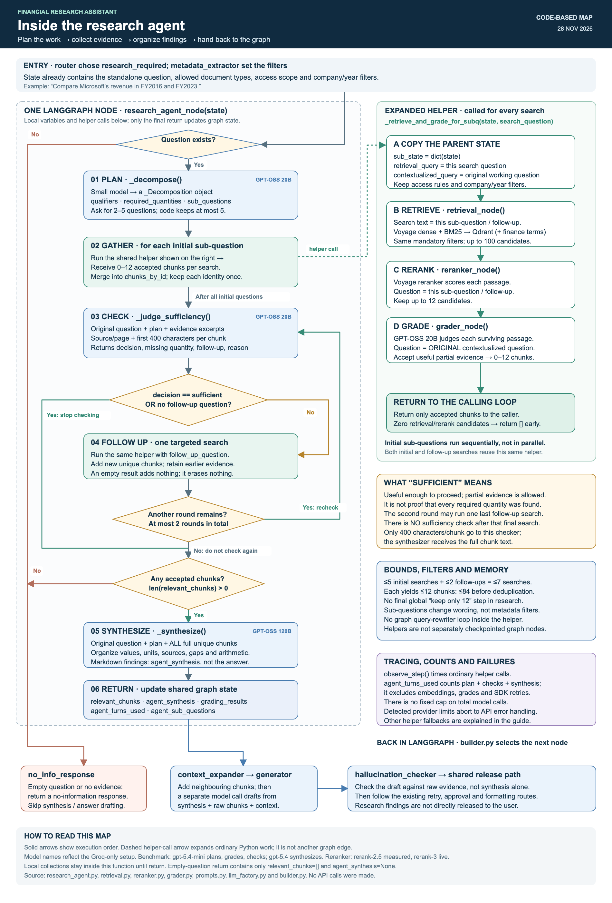
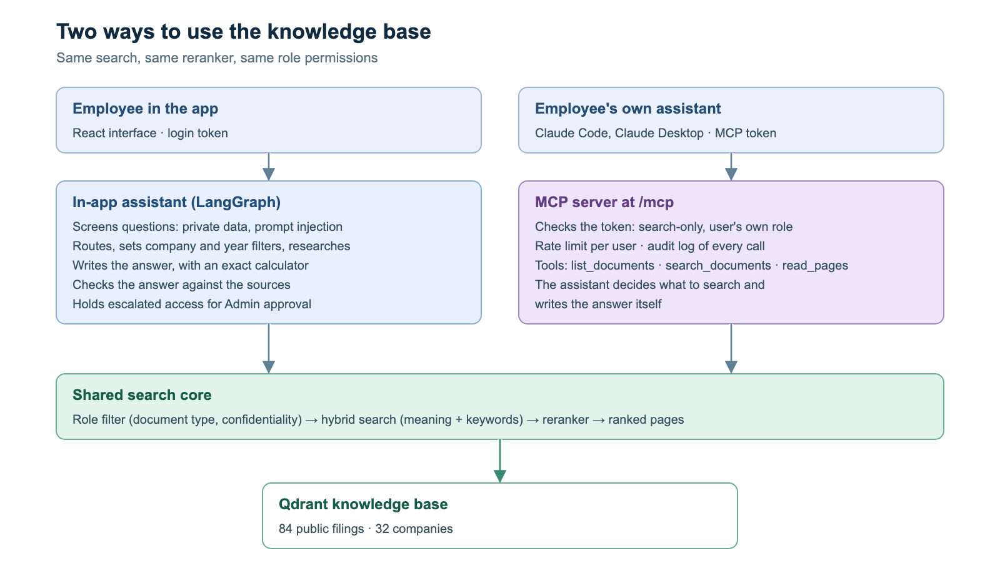

# Financial Research Assistant

A financial-document research app with a demo React interface, FastAPI backend and
LangGraph workflow. Employees ask questions in natural language and receive
answers grounded in documents available to their role. Explicit requests for
extra access hold the drafted answer for Admin review before release.

## Features

- Fixed demo accounts, JWT authentication and role-based search permissions.
- Input privacy filtering and two model-based prompt-injection checks.
- Simple lookups with hybrid retrieval, reranking, relevance grading and bounded search retries.
- A research path that decomposes questions, collects evidence and checks for missing information.
- An exact calculator the answer model calls for arithmetic; answers show each formula with its
  numbers, and the grounding check verifies a calculation's inputs instead of redoing it.
- Answer grounding checks with feedback for a bounded revision.
- Admin approval or rejection of explicitly escalated answers.
- Saved conversations, live processing stages and document/page references.
- Local request traces with workflow decisions, timings and provider-reported token usage.
- An [MCP server](docs/mcp-server.md) so employees' own AI assistants, such as Claude Code, can search
  the same documents under the same role permissions.

## Run locally

See [local setup](LOCAL_SETUP.md) for required keys, storage and first-time setup.
With Docker Desktop running and a configured `.env`:

```sh
docker compose -f compose.minimal.yml -f compose.local.yml up -d --build
```

Open **http://localhost:8000/**. Demo login: `analyst` / `analyst123`.
API documentation: **http://localhost:8000/docs**.

The default demo profile uses **Groq GPT-OSS 20B** for smaller model tasks and
**GPT-OSS 120B** for synthesis, answers and grounding checks. **Voyage Finance 2**
embeds new search queries. OpenAI and Anthropic configurations remain supported.
Model requests are subject to each provider's usage limits and pricing.

## Knowledge base

The published snapshot contains **68,059 chunks from 84 public filings across
32 companies**, including document metadata, precomputed dense vectors and sparse
BM25 vectors. The seed script loads these into Qdrant without embedding the corpus
again. A second script builds the collection the app searches, where every chunk
starts with a header naming its company, filing, page, section, financial statement
and units ([local setup](LOCAL_SETUP.md#build-the-contextual-knowledge-base)).
[Data sources and terms](DATA_SOURCES.md) identify the snapshot and source corpus.

The permission model supports additional document types and confidentiality
levels, but the active snapshot contains public filings only. Source references
include filenames and pages; a PDF can be opened only when the original file is
available locally and the user's role permits access.

## Workflow


[Zoomable SVG](docs/diagrams/langgraph-workflow.svg) ·
[Mermaid source](docs/diagrams/langgraph-workflow.mmd)

The research branch is one graph node. Its internal search loop reuses the
retrieval, reranking and grading functions, then returns evidence and a synthesis
to the shared answer-generation path.



[Zoomable SVG](docs/diagrams/research-agent-workflow.svg) ·
[Mermaid source](docs/diagrams/research-agent-workflow.mmd)

## Evaluation

Measured on the 150 public [FinanceBench](https://huggingface.co/datasets/PatronusAI/financebench)
questions. The search check asks whether the page holding the answer reaches the
answer model; the answer benchmark judges 25 full answers against reference answers.

| Version | Search check (of 150) | Answer benchmark |
| --- | --- | --- |
| Baseline | 101 | 15 / 25 (60%), median 73 s |
| Current | **145** | **20 / 24 (83%)**, median 32 s |

The [evaluation story](docs/evaluation-story.md) explains each version: why it was
changed, what changed, examples, and what was tried and dropped. Each version has a
[workflow diagram](docs/diagrams/versions/).

## Use from Claude Code and other AI assistants (MCP)

The app also serves its search as an [MCP](https://modelcontextprotocol.io) server at
`http://localhost:8000/mcp`. An employee's assistant can list, search and read the documents
their role allows, then write the answer itself; answer checks and Admin approval stay in the app.



```sh
make mcp-token MCP_USER=analyst    # prints a "claude mcp add ..." command to run
```

On FinanceBench the search tool returns the answer page within its default 8 results for 145 of
150 questions. The [MCP guide](docs/mcp-server.md) covers the tools, tokens, limits and other clients.

## Code layout

| Folder | Contents |
| --- | --- |
| `frontend/` | React screens, Axios requests, styles and browser tests |
| `src/api/` | Login, conversations, Admin approvals, PDF access and health routes |
| `src/graph/` | Graph construction, routing decisions and workflow nodes |
| `src/services/` | Retrieval, reranking, models, privacy, persistence and request traces |
| `src/config/` | Settings, prompts and role permissions |
| `src/models/` | Request/response schemas and graph state |
| `src/mcp_server/` | MCP server: document search tools, tokens and the `/mcp` endpoint |
| `scripts/seed_from_hf.py` | Restore the published knowledge base into an empty Qdrant collection |
| `scripts/build_contextual_collection.py` | Build the knowledge base with contextual chunk headers |
| `scripts/build_diagrams.py` | Generate the workflow diagrams |
| `scripts/create_mcp_token.py` | Create an MCP token and print the Claude Code command |
| `tests/` | Unit and integration regression checks |
| `tests/evaluation/financebench/` | Search check, MCP search check and answer benchmark |
| `docs/evaluation-story.md` | How each version was measured and improved |
| `docs/mcp-server.md` | MCP tools, connection, tokens and limits |
| `docs/diagrams/` | Workflow diagrams, one per version, and editable sources |

## Checks

Backend tests use mocked model responses; integration tests need separately
configured test services. Frontend tests intercept API requests.

```sh
python -m pytest tests/unit tests/integration
cd frontend
npm test
npm run build
```

Fixed accounts and a single API worker keep the local demo simple. A production
rollout would need real account management and shared concurrency controls.

