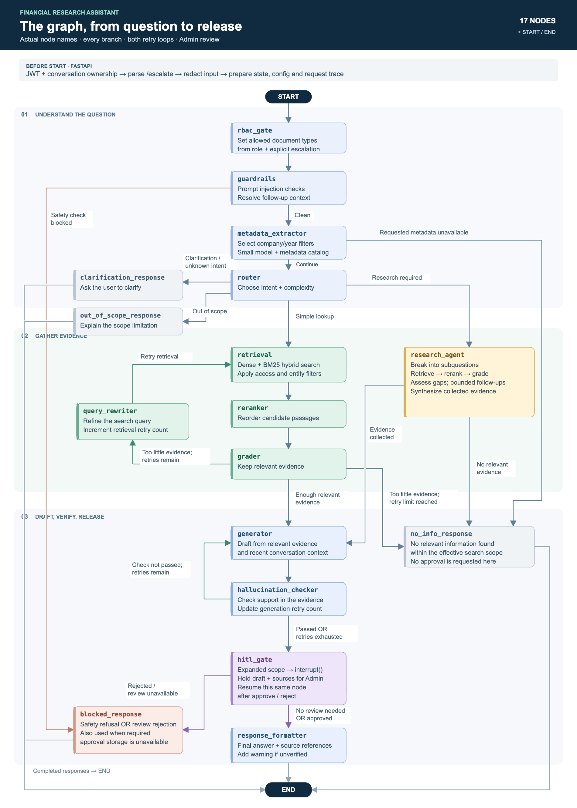
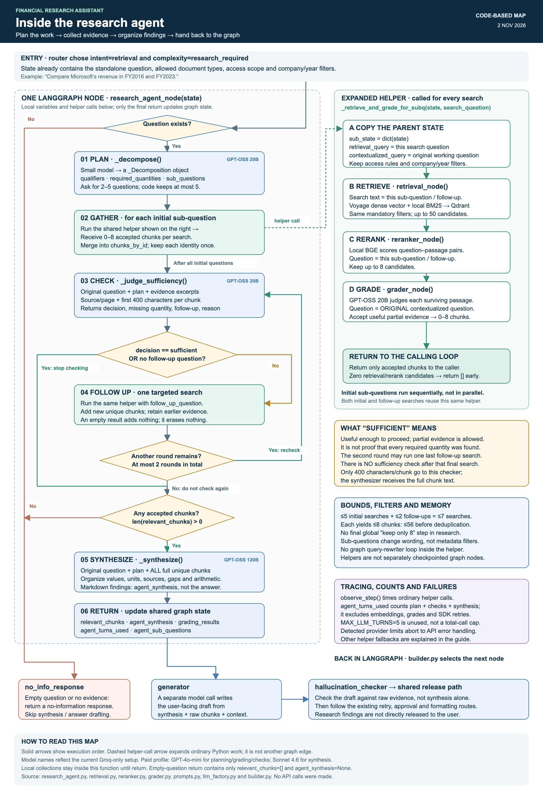

# Financial Research Assistant

A financial-document research app with a demo React interface, FastAPI backend and
LangGraph workflow. Employees ask questions in natural language and receive
answers grounded in documents available to their role. Explicit requests for
extra access hold the drafted answer for Admin review before release.

## Features

- Fixed demo accounts, JWT authentication and role-based search permissions.
- Input privacy filtering and two model-based prompt-injection checks.
- Simple lookups with hybrid retrieval, reranking, relevance grading and bounded search retries.
- A research path that decomposes questions, collects evidence and checks for missing information.
- Answer grounding checks with feedback for a bounded revision.
- Admin approval or rejection of explicitly escalated answers.
- Saved conversations, live processing stages and document/page references.
- Local request traces with workflow decisions, timings and provider-reported token usage.

## Run locally

See [local setup](LOCAL_SETUP.md) for required keys, storage and first-time setup.
With Docker Desktop running and a configured `.env`:

```sh
docker compose -f compose.minimal.yml -f compose.local.yml up -d --build
```

Open **http://localhost:8000/**. Demo login: `analyst` / `analyst123`.
API documentation: **http://localhost:8000/docs**.

The default demo profile uses **Groq GPT-OSS 20B** for smaller model tasks and
**GPT-OSS 120B** for synthesis, answers and grounding checks. **Voyage Finance 2**
embeds new search queries. OpenAI and Anthropic configurations remain supported.
Model requests are subject to each provider's usage limits and pricing.

## Knowledge base

The published snapshot contains **68,059 chunks from 84 public filings across
32 companies**, including document metadata, precomputed dense vectors and sparse
BM25 vectors. The seed script loads these into Qdrant without embedding the corpus
again. [Data sources and terms](DATA_SOURCES.md) identify the snapshot and source corpus.

The permission model supports additional document types and confidentiality
levels, but the active snapshot contains public filings only. Source references
include filenames and pages; a PDF can be opened only when the original file is
available locally and the user's role permits access.

## Workflow



[Zoomable SVG](docs/diagrams/langgraph-workflow.svg) ·
[Mermaid source](docs/diagrams/langgraph-workflow.mmd)

The research branch is one graph node. Its internal search loop reuses the
retrieval, reranking and grading functions, then returns evidence and a synthesis
to the shared answer-generation path.



[Zoomable SVG](docs/diagrams/research-agent-workflow.svg) ·
[Mermaid source](docs/diagrams/research-agent-workflow.mmd)

## Code layout

| Folder | Contents |
| --- | --- |
| `frontend/` | React screens, Axios requests, styles and browser tests |
| `src/api/` | Login, conversations, Admin approvals, PDF access and health routes |
| `src/graph/` | Graph construction, routing decisions and workflow nodes |
| `src/services/` | Retrieval, models, privacy, caches, persistence and request traces |
| `src/config/` | Settings, prompts and role permissions |
| `src/models/` | Request/response schemas and graph state |
| `scripts/seed_from_hf.py` | Restore the published knowledge base into an empty Qdrant collection |
| `tests/` | Unit and integration regression checks |
| `docs/diagrams/` | Workflow diagrams and editable sources |

## Checks

Backend tests use mocked model responses; integration tests need separately
configured test services. Frontend tests intercept API requests.

```sh
python -m pytest tests/unit tests/integration
cd frontend
npm test
npm run build
```

Fixed accounts and a single API worker keep the local demo simple. A production
rollout would need real account management and shared concurrency controls.

