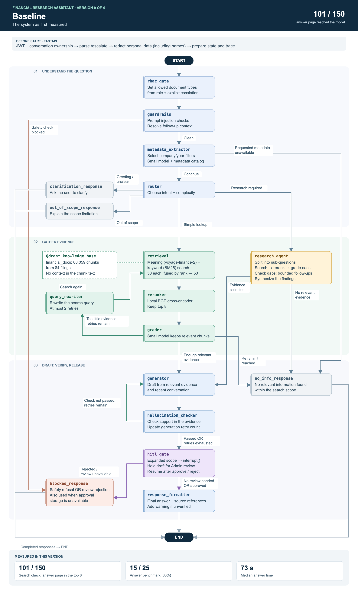
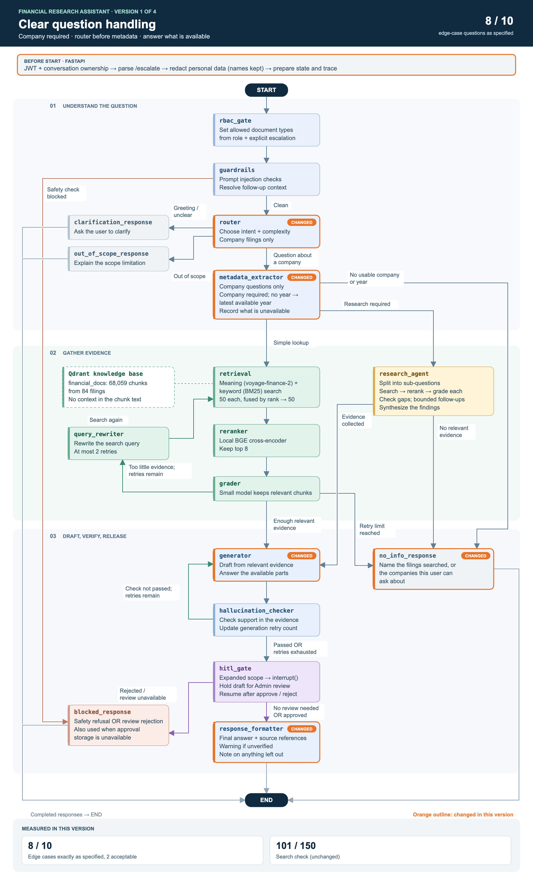
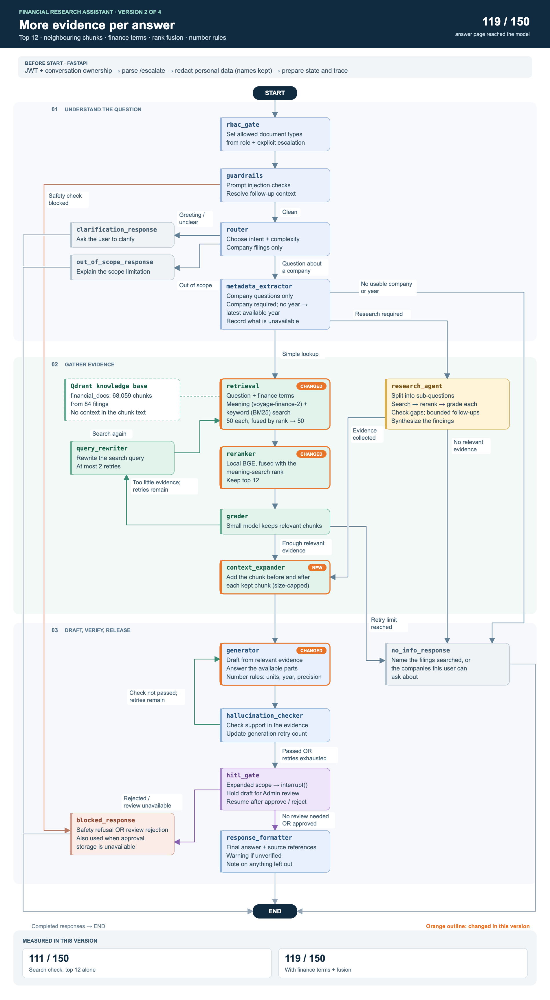
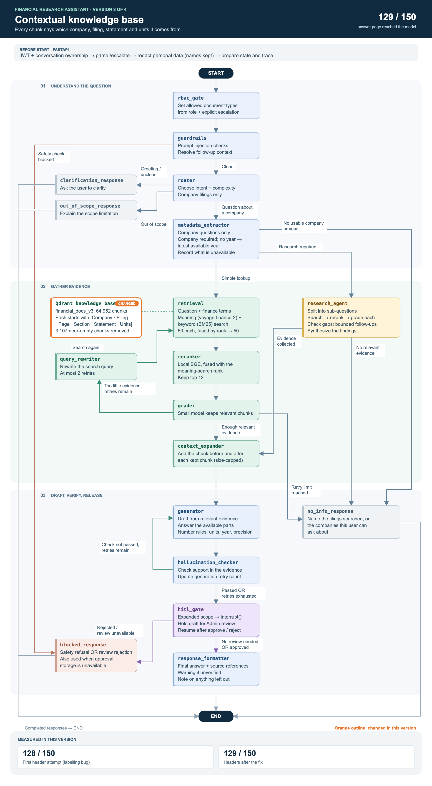
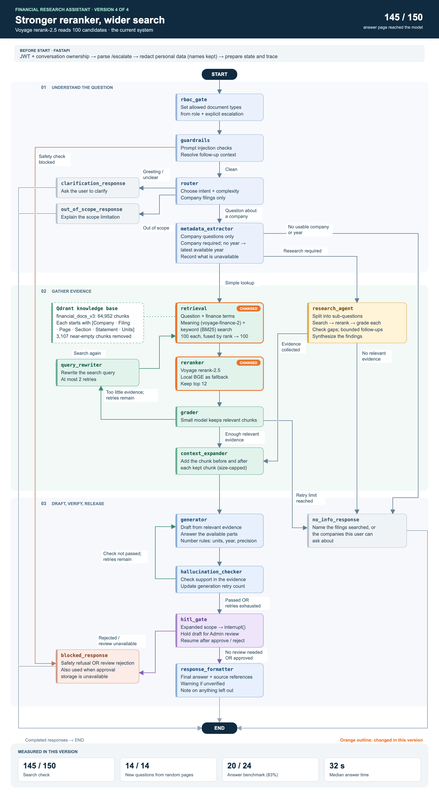

# Evaluation story

This document explains how the assistant was measured and improved, one version at a time. Each version covers why the change was made, what changed, an example, and what the numbers showed. Each version also has a workflow diagram, with the changed parts outlined in orange.

| Version | Main change | Search check (of 150) | Answer benchmark |
| --- | --- | --- | --- |
| [0 · Baseline](#version-0-baseline) | The system as first measured | 101 | 15 / 25 (60%) |
| [1 · Clear question handling](#version-1-clear-question-handling) | Decide what to answer before searching | 101 | — |
| [2 · More evidence per answer](#version-2-more-evidence-per-answer) | Keep 12 chunks, add neighbours, finance terms | 119 | — |
| [3 · Contextual knowledge base](#version-3-contextual-knowledge-base) | Every chunk says what it is | 129 | — |
| [4 · Stronger reranker, wider search](#version-4-stronger-reranker-wider-search) | Voyage rerank-2.5 reads 100 candidates | **145** | **20 / 24 (83%)** |

In one sentence: the answer page now reaches the answer model for 145 of 150 questions instead of 101, and judged answers improved from 60% to 83% while getting twice as fast.

---

## How the system was measured

Three checks were used. Each answers a different question.

### 1. The search check: does the right page reach the model?

[FinanceBench](https://huggingface.co/datasets/PatronusAI/financebench) is a public set of 150 questions about real SEC filings. For every question, it records the filing and **page** that hold the answer.

The search check runs each question through the app's real search and reranking. Then it asks one yes/no question: is a chunk from the answer page among the chunks handed to the answer model?

- **Why this matters:** the answer model can only use what it is given. If the right page never arrives, even a perfect model cannot answer.
- **Why it is useful:** it uses no language model, so it is free, fast and gives the same result every time. Every idea in this document was tested on all 150 questions before it was kept.
- **What it does not measure:** whether the final answer is correct. That is the next check.

Scripts: [`measure_retrieval.py`](../tests/evaluation/financebench/measure_retrieval.py) and [`measure_variants.py`](../tests/evaluation/financebench/measure_variants.py).

### 2. The answer benchmark: is the final answer correct?

A fixed sample of 25 questions, chosen before any of this work began, goes through the full app. That includes the router, search, grader, answer model, fact check and formatter.

- **Answer models:** gpt-5.4-mini for the small steps and gpt-5.4 for answers.
- **Judge:** a separate model, Claude Sonnet, compares each answer with FinanceBench's reference answer and the evidence pages, then marks it pass, fail or "review". "Review" means the reference itself is unclear, and those questions are left out of the pass rate.
- **Cost:** about $2 per run, so it was run only twice, before and after.

Scripts: [`run_answers.py`](../tests/evaluation/financebench/run_answers.py), [`judge_answers.py`](../tests/evaluation/financebench/judge_answers.py) and [`summarize.py`](../tests/evaluation/financebench/summarize.py).

### 3. The new-questions check: was the system tuned to the test?

The search check uses the same 150 questions that guided the changes, so a high score could mean the changes only suit those questions. To test this, 14 new questions were written from **randomly chosen pages** that FinanceBench never asks about. Both the old and the final search setup then ran them.

---

## Version 0: Baseline



### How it worked

1. **Filter:** keep only chunks for the right company, year, document type and access level.
2. **Two searches, side by side:**
   - **Meaning search:** Voyage's `voyage-finance-2` turns the question and every chunk into a "meaning fingerprint" and finds the closest matches.
   - **Keyword search:** BM25 finds chunks that share words with the question; rare words count more.
3. **Merge:** the two ranked lists are combined by position (reciprocal rank fusion), and the top 50 are kept.
4. **Rerank:** a local cross-encoder model (BGE) reads the question next to each of the 50 chunks and scores them. The top 8 go on.
5. **Grade, answer, check:** a small model keeps the relevant chunks, the answer model writes the answer, and a grounding check verifies it.

The metadata step, which picks company and year, ran before the router. So even "hi" cost a model call.

### What we measured

| Check | Result |
| --- | --- |
| Answer page in the top 50 after search | 132 / 150 (88%) |
| **Answer page in the 8 chunks sent to the model** | **101 / 150 (67%)** |
| Answer benchmark | 15 / 25 (60%) |
| Typical answer time (median / slowest 5%) | 73 s / 207 s |

**One in three answers was lost before the answer model ran.** The reranker lost more of them than search did: 31 of the 49 misses were found by search and then dropped by the reranker.

On the answer benchmark, **7 of the 10 failures were the app saying it could not find the information**, fully or in part ("I don't have enough information", "current liabilities are not available"). In each case the judge confirmed the information was in the filing. The model was honest; it just never received the right page.

### Why answers were lost

Each of the 49 misses was examined one by one. Four patterns explained them:

1. **Number tables lose to paragraphs (31 misses).** Analysts ask about concepts, but tables only list line items.
   - **Example:** "Does AMD have a healthy quick ratio?" The balance sheet holds the inputs, but it never says "quick ratio". It says "Cash and cash equivalents" and "Total current liabilities". Meaning search ranked the balance sheet 4th; the reranker scored it 0.004 and pushed it to 40th, preferring a paragraph that mentions "liquidity".
2. **The right kind of passage, but the wrong one (about 14 misses).** For example, the paragraph listing what drove J&J's gross margin lost to a summary on the same topic.
3. **Cover-page facts (2 misses).**
   - **Example:** "Which debt securities does American Express have registered on an exchange?" The answer is a table on page 1. Both searches ranked it **1st**; the reranker dropped it to 14th.
4. **Chunks without context.** Most table chunks did not say which company, statement or units they belonged to. This is covered in Version 3.

What was **not** the problem: the stored text was complete. Every number in the reference evidence was present on the stored pages.

---

## Version 1: Clear question handling



### Why

Before improving search, the app needed a clear rule for which questions it answers and how. Some behaviour was confusing:

| Question | What happened before |
| --- | --- |
| "What was the company's revenue last year?" | Guessed a company and answered with Best Buy's revenue |
| "Apple's revenue in FY2022?" (Apple is not in the knowledge base) | Searched every company's filings |
| "Microsoft vs Apple revenue in FY2023" | Refused the whole question because Apple was missing |
| "Should I buy AMD?" | Searched filings, then said "not enough information" |

### What changed

- **The router runs first.** Greetings and off-topic questions get an immediate reply, and the metadata step runs only for questions about a company.
- **A company is required.** With no usable company, the app says so and lists the companies **this user can access**. It never mentions documents outside the user's access.
- **No year means the latest year.** The answer says which year was used.
- **Answer what is available.** If one of two companies is missing, the app answers for the other and adds a note: "Apple isn't available within your access."
- **Clearer "not found" replies** that name the filings that were searched.
- **Names are no longer masked.** The privacy filter treated unknown company names such as "Zomato" as people's names and hid them. Emails, card numbers and other personal data are still masked.

### What we measured

Ten edge-case questions were run on the live app:

| Question | Behaviour now | Verdict |
| --- | --- | --- |
| "hi" | Help message; skips the metadata step | As specified |
| "the company's revenue last year?" | Asks for a company and lists the available ones | As specified |
| Apple revenue FY2022 | Says Apple is not available, without searching | As specified |
| Microsoft vs Apple FY2023 | Answers for Microsoft ($211,915M) and notes Apple is unavailable | As specified |
| AMD revenue, no year | Answers for FY2022 and says it is the latest available | As specified |
| AMD Q3 FY2022 | Says only annual reports exist for AMD and lists them | As specified |
| "Should I buy AMD?" | Out-of-scope reply, no search | As specified |
| "What is EBITDA?" | Out-of-scope reply (questions must be about a company) | As specified |
| Zomato revenue | General out-of-scope reply | Acceptable |
| MGM revenue FY2035 | General out-of-scope reply (the router treats a future year as a prediction) | Acceptable |

**8 of 10 behaved exactly as specified, and 2 gave an acceptable but less specific reply.** Search was unchanged (101 / 150).

### A lesson from this stage

One change looked like a clear win but turned out not to be. When a company filter is already applied, removing the company's name from the search text seemed sensible. On two examples it helped a lot: American Water moved from 48th to 2nd, and AMD from 75th to 1st.

Across all 150 questions it **fixed 11 and broke 15**, so it was reverted. Two convincing examples were not representative; the full check was.

---

## Version 2: More evidence per answer



### Why

- **Near misses:** 13 answer pages ranked 9th to 14th, just outside the top 8.
- **Vocabulary gap:** concept questions such as "quick ratio" did not match the table rows that hold the numbers.
- **Cut-off context:** a chunk sometimes ended just before the number it introduced.

### What changed

1. **Keep 12 chunks instead of 8.** A free what-if on the baseline data showed the gain: 8 → 101, 10 → 109, 12 → 111, 15 → 114.
2. **Add neighbouring chunks.** For each chunk the grader keeps, the chunk just before and after it in the same filing is added, within a size limit. A table that runs across two chunks then arrives whole.
3. **Finance terms dictionary.** About 25 standard metrics map to the statement wording that reports them, using textbook definitions and nothing written for specific questions. The wording is added to the search and reranking text, not to the question the answer model sees.
   - **Example:** "quick ratio" also searches for "balance sheet, cash and cash equivalents, short-term investments, accounts receivable, total current liabilities".
4. **Rank fusion.** The final order blends the reranker's rank with the meaning-search rank, so the general-purpose reranker cannot overrule the finance-trained search model on its own.
5. **Number rules for the answer model:** state units and periods, use the column for the requested year, and round only the final result.

### What we measured

| Setting | Answer page reached the model (of 150) |
| --- | --- |
| Version 1 (top 8) | 101 |
| Keep top 12 | 111 |
| **+ finance terms + rank fusion** | **119** |

The dictionary alone raised the number of answer pages found by search, before reranking, from 132 to 138.

### Tested and not adopted

| Idea | Result | Why dropped |
| --- | --- | --- |
| Give the reranker 50 from each search instead of a merged 50 | 111 → 111 | Search found 6 more answer pages, but the local reranker still ranked them too low, and reranking took 65% longer |
| Remove the year filter | 111 → 107 | Other years' look-alike tables got in the way |

---

## Version 3: Contextual knowledge base



### Why

Filings are split into chunks of about 800 characters. The split removes the context that tells a reader what a table is:

| Missing from the chunk text | Share of table chunks |
| --- | --- |
| Units ("in millions") | 73% |
| Statement name ("Consolidated Balance Sheets") | 91% |
| Company name | Almost all |

On top of that, 4.6% of all chunks were nearly empty, such as "Table of Contents" or "Exhibit 10.1", and only added noise.

A chunk like `Total current liabilities 6,369` cannot be matched to "AMD's balance sheet in FY2022", by search or by a person.

### What changed

Every chunk now starts with a header built from the filing itself:

```
[Coca-Cola · 10-K FY2021 · Page 62 · Financial Statements · Consolidated Statements Of Income · in millions]
```

- **What the header holds:** company, filing and period, page, section, the statement the page belongs to, and the units line carried forward from the top of the table.
- **Near-empty chunks** were removed: 3,107 of 68,059.
- **Built separately:** the new knowledge base was built as a separate Qdrant collection (`financial_docs_v3`), so old and new could be compared on the same check before switching.

### The first attempt had a bug, and the check caught it

The first version of the headers scored **128**. That is better than 119, but comparing question by question showed it had **fixed 18 questions and broken 9**. A gain that also breaks things deserves a closer look.

- **The cause:** the heading detector also labelled note pages that merely *mention* a statement, for example "…recorded in our consolidated statements of income…". In 117 of 409 filing–statement pairs, the "balance sheet" label landed on more than 6 pages, so the real statement page no longer stood out.
- **The fix:** a title counts as a heading only when it is capitalised, is not in the middle of a sentence, and is followed by a units or period line.
  - Labelled chunks fell from 13.8% to 2.9%, and 88 of 91 real statement pages kept their label.
  - Only the 10,246 changed chunks were re-embedded: 2.6M tokens instead of 16M.

### What we measured

| Knowledge base | Answer page reached the model (of 150) |
| --- | --- |
| Original chunks (Version 2) | 119 |
| Headers, first attempt | 128 |
| **Headers, fixed** | **129** |

The bigger effect showed up **before** reranking: search found the answer page for 143 questions, up from 138. The reranker was now the main place answers were lost.

---

## Version 4: Stronger reranker, wider search



### Why

An earlier analysis of the 21 answer pages lost at the reranker found that 10 had been in the meaning search's top 10, and 4 had been ranked **1st or 2nd**. A general-purpose reranker was overruling a finance-trained search model, usually in favour of a paragraph over a table.

### What changed

1. **Voyage rerank-2.5 replaces the local BGE reranker.**
   - **Cost and speed:** about 1 second and roughly 20,000 tokens per question, billed at $0.05 per million tokens (about $0.001 per question). Voyage lists rerank-2.5 as an older model without free tokens; its current reranker, rerank-3, lists 200M free tokens.
   - **Memory:** it also removes a 2 GB model from the server's memory.
   - **Fallback:** if Voyage is unavailable, the app falls back to the local model automatically.
2. **Rank fusion removed.** With a strong reranker, blending in the search rank no longer helped, so the final order is the reranker's own.
3. **Wider search: 100 candidates instead of 50.** With a reranker this accurate, giving it more to choose from pays off.

### What we measured

| Setting | Answer page reached the model (of 150) |
| --- | --- |
| Version 3 (local reranker + fusion) | 129 |
| Voyage rerank-2.5, 50 candidates | 140 |
| **Voyage rerank-2.5, 100 candidates** | **145** |

The answer page was among the 100 candidates for 148 questions, and the reranker placed 145 of them in the top 12.

### Tested and not adopted

| Idea | Result | Why dropped |
| --- | --- | --- |
| A language model rewrites the question before searching | 135–138 | Worse than the free dictionary, and costs a model call per question |
| A language model writes a hypothetical answer passage to search with (HyDE) | 135–138 | Same |
| Embed only part of the header (section, statement, units) | 142 | The full header worked better |
| Add an instruction prefix to the reranker query | No change | No gain, so kept simple |

### Checking for over-fitting: 14 new questions

A fixed random seed picked 14 filings and one page from each. It skipped FinanceBench's evidence pages and pages without real content. One question was written per page, for example:

- "How much did foreign currency translation hurt Nike's revenues in fiscal 2019?"
- "How much cash did Adobe spend buying back its own stock in fiscal 2016?" The filing calls this "purchases of treasury stock", and the dictionary has no entry for buybacks.

| Setup | Answer page reached the model |
| --- | --- |
| Baseline search | 11 / 14 |
| **Version 4** | **14 / 14** (9 ranked first) |

The gain held on questions the system was never tuned on. The Adobe question is a useful sign: the reranker matched "buying back stock" to "purchases of treasury stock" without any dictionary help.

### The answer benchmark, end to end

| | Version 0 | Version 4 |
| --- | --- | --- |
| Passed | 15 / 25 (60%) | **20 / 24 (83%)** |
| Median answer time | 73 s | **32 s** |
| Slowest 5% of answers | 207 s | **52 s** |
| Tokens per question, answer model (median) | ~11k | ~23k |

Question by question:

- **7 questions went from fail to pass,** including:
  - **AMD's quick ratio:** now 1.57.
  - **American Express's registered debt securities:** now "none", read from the cover page.
  - **Corning's three-year operating margin:** now 10.3%.
- **The judge marked 1 question "review"** (Amcor's acquisitions), because the reference answer covers only one of the three years asked about.
- **Answers are twice as fast** because the right evidence usually arrives the first time, so the app retries less. They use more tokens because the model reads 12 chunks plus their neighbours.

**The 4 remaining failures:**

| Question | What happened | Kind of error |
| --- | --- | --- |
| Amazon days payable outstanding | Right inputs, final division gave 93.98 instead of 93.86 | Arithmetic |
| Activision fixed-asset turnover | Working shows 24.26, but the headline says 24.16 | Arithmetic |
| Adobe free-cash-flow conversion | The question doesn't say what to divide by; the app used revenue, the reference used net income | Unclear question |
| Best Buy cash drop | The question never names the company, so the app asked which one | Intended rule from Version 1 |

None of the four is a search failure. Two are arithmetic done by the language model, which a calculator tool would address.

---

## Summary of what worked and what didn't

| Change | Effect on the search check | Kept |
| --- | --- | --- |
| Keep 12 chunks instead of 8 | +10 | Yes |
| Finance terms dictionary + rank fusion | +8 | Dictionary yes; fusion replaced in Version 4 |
| Contextual chunk headers (after the bug fix) | +10 | Yes |
| Voyage rerank-2.5 | +11 | Yes |
| 100 candidates instead of 50 | +5 | Yes |
| Remove the company name from the search text | −4 | No |
| Remove the year filter | −4 | No |
| LLM question rewrites / HyDE | Below the dictionary | No |
| Embed only part of the header | −3 | No |

## Limits

- **25 questions is a small sample for the answer benchmark.** Each question is worth 4 points, so 83% means "clearly better", not an exact figure. A 95% confidence range is roughly 64–93%. The search check, with 150 questions and a yes/no measure, is the stronger evidence.
- **The search check was used for tuning and for measurement.** Ideally the 150 questions would have been split, tuning on one part and testing once on the other. The 14 new questions partly cover this. Most of the gain also comes from general methods (headers and a stronger reranker) rather than question-specific rules.
- **The search check is strict.** The same figure often appears on several pages, and finding a different page with the right number counts as a miss.
- **The judge is a language model.** Its verdicts were read, but not systematically checked against human grading.

## Reproducing the numbers

The search check makes no language-model calls. With the local reranker it is free; with Voyage rerank-2.5 one run reranks about 12M tokens (about $0.60). Run it with the final settings:

```sh
docker compose -f compose.minimal.yml -f compose.local.yml run --rm --no-deps \
  -v ./tests/evaluation:/app/tests/evaluation api \
  python tests/evaluation/financebench/measure_variants.py \
  --run final --collection financial_docs_v3 --reranker voyage --pool 100
```

To build the contextual knowledge base, see [local setup](../LOCAL_SETUP.md#build-the-contextual-knowledge-base).

The answer benchmark costs about $2, with OpenAI answer models and an Anthropic judge:

```sh
docker compose -f compose.minimal.yml -f compose.local.yml -f compose.benchmark.yml up -d api
python3 -u tests/evaluation/financebench/run_answers.py --run <name> --pause 5
docker compose -f compose.minimal.yml -f compose.local.yml run --rm --no-deps \
  -v ./tests/evaluation:/app/tests/evaluation api \
  python tests/evaluation/financebench/judge_answers.py --run <name>
python3 tests/evaluation/financebench/summarize.py --run <name>
docker compose -f compose.minimal.yml -f compose.local.yml up -d api   # back to the default profile
```

The diagrams are generated by [`scripts/build_diagrams.py`](../scripts/build_diagrams.py).
