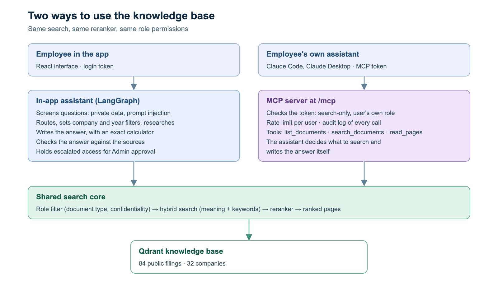

# MCP server

The knowledge base can be used in two ways:

1. **The in-app assistant.** The app owns everything: it plans the search, writes the answer,
   checks the answer against the sources, screens questions for prompt injection and private data,
   and holds escalated answers for Admin approval.
2. **An employee's own AI assistant**, such as Claude Code or Claude Desktop, through the
   [Model Context Protocol](https://modelcontextprotocol.io) (MCP). The app offers search as tools;
   the assistant decides what to search, reads the results and writes the answer itself.

Both use the same search, the same reranker and the same role permissions. An MCP caller never
sees a document its role cannot see.



| | In-app assistant | MCP (employee's assistant) |
| --- | --- | --- |
| Who writes the answer | The app's models and prompts | The employee's assistant |
| Hybrid search and reranking | Yes | Yes (same code) |
| Role permissions | Yes | Yes (same filters) |
| Question screening (privacy, prompt injection) | Yes | Not applicable: no app model reads the query |
| Answer checked against sources | Yes | No: the assistant is responsible |
| Escalation and Admin approval | Yes | No: MCP callers get their ordinary role only |
| Conversation history | Saved by the app | Kept by the assistant |
| Model cost | Paid by the app | Paid by the employee's assistant; search costs one embedding and one rerank |

## Tools

| Tool | What it does |
| --- | --- |
| `list_documents` | Companies, fiscal years and documents the caller can search, plus the caller's role and access. Optional `company` filter. |
| `search_documents` | Hybrid search and reranking. Filters: `companies` (names, tickers or slugs), `fiscal_years`, `document_types`; `max_results` (1 to 20, default 8). Returns one result per page, ranked, with document, page, statement, units and a citation such as `AMAZON_2017_10K, page 40`. |
| `read_pages` | Full text of up to five pages of one document, for tables or notes a result cuts off. |

The server also offers a `research` prompt, which appears in Claude Code as
`/mcp__financial-research__research`. It asks the assistant to filter by company and year, check
units, show each calculation with its numbers and cite every figure.

Behaviour worth knowing:

- **Fiscal years** follow the in-app rule: a request for FY2017 also searches filings up to two
  years later, because annual reports repeat earlier years for comparison. The response says so.
- **Company names** can be written as people write them: "Pfizer Inc.", "The Boeing Company",
  "JNJ", "Lockheed". An ambiguous name such as "American" returns the choices.
- **Errors** are plain sentences the assistant can act on, for example the fiscal years that are
  available. They never reveal whether a restricted document exists.
- **Document text** is returned as data with a notice not to follow instructions inside it.
- **Response size** stays small: a default search returns about 2,500 to 4,000 tokens, five pages
  about 2,000, and the full document list about 2,500.

## Connect Claude Code

With the app running, add the server once:

```sh
claude mcp add --transport http financial-research http://localhost:8000/mcp
```

Then, in Claude Code, run `/mcp`, choose `financial-research` and select **Authenticate**. A
browser tab opens on the app's consent page: sign in with your usual account (if you are not
already signed in) and select **Allow access**. Claude Code stores the tokens and renews them by
itself; `claude mcp list` shows `financial-research ... ✔ Connected`.

Ask, for example: *"Using the financial-research tools, what was Amazon's days payable
outstanding in FY2017? Show the calculation and cite pages."*

The connection has the role of the account that approved it. The app's **Connect Claude Code**
page shows the same steps with the server's configured address.

### Other clients

Any MCP client that supports remote servers over Streamable HTTP with OAuth can use the same
address. It discovers everything else from the server:

1. A request without a token gets `401` with
   `WWW-Authenticate: Bearer resource_metadata=".../.well-known/oauth-protected-resource/mcp"`.
2. The resource metadata names the authorization server (the app itself), whose metadata at
   `/.well-known/oauth-authorization-server` lists the `/authorize`, `/token`, `/register` and
   `/revoke` endpoints.
3. The client registers itself (dynamic client registration), then runs the authorization-code
   flow with PKCE (`S256`). The user signs in and approves on `/oauth/consent`.

Hosted clients (for example Claude Desktop's custom connectors) need the app on a public HTTPS
address; see [deployment](deployment.md).

## Sign-in, tokens and access

- **Same accounts as the app.** There is no separate MCP password or token to hand out; anyone
  with an account can connect their own client, and only they can approve it.
- **Access tokens** are JWTs valid for `ACCESS_TOKEN_MINUTES` (default 60) and checked against the
  account and session on every call (a deactivated account or ended connection is refused at once), with the `documents:read`
  scope and the MCP address as their audience. The app's API rejects them, so they cannot open
  conversations, approve escalations or change accounts; the MCP endpoint rejects the app's own
  tokens.
- **Refresh tokens** rotate on every use and are stored only as hashes. Reusing an old one ends the
  connection. Renewal checks the account, so a password change, deactivation or "sign out
  everywhere" stops a client within the hour. Connections end after `SESSION_IDLE_DAYS` without use
  (default 7) or `SESSION_MAX_DAYS` after approval (default 30).
- **Disconnect** a client under Account → Sessions in the app; administrators can end any user's
  sessions from the Users page. Clients can also revoke their own tokens at `/revoke`.
- **Consent requests** expire after 10 minutes and authorization codes after 2 minutes; a code used
  twice ends the connection it created.
- **Registration** is open, as MCP clients expect, but limited per IP address
  (`MCP_CLIENT_REGISTRATIONS_PER_HOUR`). A client may receive sign-in codes only on localhost (as
  Claude Code does) or on an `https` host listed in `MCP_REDIRECT_HOSTS` (default `claude.ai` and
  `claude.com`, for Claude's hosted apps), so nobody can register a look-alike client that sends codes
  to their own server. A registration alone grants nothing: a user still has to sign in and approve.
- **Rate limit.** `MCP_RATE_LIMIT_PER_MINUTE` searches and page reads per user (default 30).
- **Host check.** Requests must name an allowed host (`MCP_ALLOWED_HOSTS`), which blocks
  DNS-rebinding attacks from web pages. Add your domain when serving beyond localhost.
- **Audit log.** Every tool call logs one line (`src.mcp_server.audit`) with the user, role, session
  id, tool, filters, result count, status and duration. Query text is not logged; its length is.
  Connections and disconnections appear in the app's Activity log.

## Measured

On the 150 FinanceBench questions, calling `search_documents` the way an assistant would (the
question as the query, the company name and the filing's fiscal year, analyst role):

| Results returned | Top 5 | Top 8 (default) | Top 12 |
| --- | --- | --- | --- |
| One result per page (current) | 140 | **145** | 145 |
| One result per chunk (first version) | 135 | 142 | 145 |

Median search time 1.1 s. Reproduce with
`python tests/evaluation/financebench/measure_mcp_search.py --run <name>` (no language model is
called; one embedding and one rerank per question).

### Role permissions

The knowledge base holds public filings only, so the permissions were also checked on a temporary
copy in which real chunks were relabelled as an internal expense policy and a confidential board
report. With the real search, each role listed, found and read exactly what it may see: analysts
the public filing only, HR the policy only, finance both, and C-level and Admin everything. The
board report could not be listed, searched or read by any other role.

### With an assistant

A small, free model (Groq GPT-OSS 120B) was given only these tools over MCP and asked 10
FinanceBench questions, with results trimmed to fit its 8,000 tokens-per-minute limit:

| Outcome | Questions |
| --- | --- |
| Correct (7) | Adobe free-cash-flow conversion; Best Buy cash change (the question names no company, so the assistant found it with `list_documents`); 3M capital expenditure; Coca-Cola return on assets; Boeing net PP&E; MGM's weakest region (read the full segment table with `read_pages`); Activision fixed-asset turnover |
| Wrong (2) | Amcor quick ratio: used a "Deed of Cross Guarantee" balance sheet (a subset of subsidiaries) ranked above the consolidated one; Best Buy gross margins: correct yearly figures, but called the trend unstable |
| Did not finish (1) | Amazon DPO: the model repeatedly produced malformed tool calls, a known GPT-OSS formatting fault |

The answer pages were in the results in every case; the mistakes came from choosing between them.

## Limits

- The MCP rate limit is kept in memory for one API process; several processes would need a shared
  store such as Redis.
- The document list is read once per API process, like the in-app catalog. Restart the API after
  adding documents.
- Access tokens are signed with the app's `JWT_SECRET`. Rotating the secret ends every access token
  at once (refresh tokens keep working and issue new ones).
- A role change applies when the client next renews its access token, within the hour.
- Answers written by an external assistant are not checked by the app. Use the in-app assistant
  where answers must be verified or approved.

## Troubleshooting

| Symptom | Fix |
| --- | --- |
| `401` or "needs authentication" | Run `/mcp` in Claude Code and choose Authenticate again (the connection was ended, or the password changed). |
| "Connection request unavailable" in the browser | The consent link expired (10 minutes): start again from the client. |
| Sign-in fails with "invalid_request ... resource" | The client was added with a different address than `PUBLIC_URL`; use the address shown on the Connect page. |
| `421` / "Invalid Host header" | Add the host name to `MCP_ALLOWED_HOSTS`. |
| `503` "The MCP server is not running" | `MCP_ENABLED` is false, or the API is still starting. |
| Claude Code shows "Failed to connect" | Start the app (`make up`) and check `http://localhost:8000/v1/health`. |
